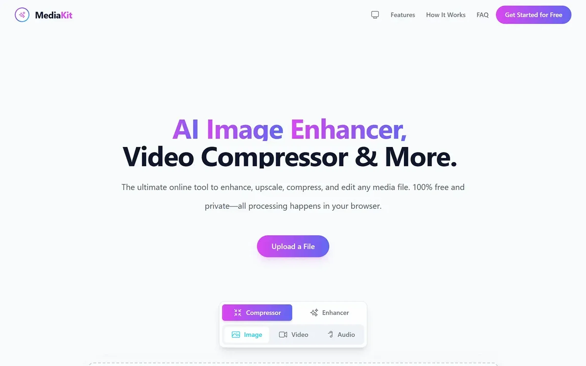

# Exect Media Kit

**A central home for creator assets, brand guidelines and media resources.**

    

## Overview

An interactive media kit that brings authorized brand assets, guidelines and resources into one place. The React and Vite project gives digital creators a consistent reference for working with the brand.

## The challenge

Partners and affiliates were representing the brand inconsistently.

## The solution

A single hub for official brand assets and guidelines, so every channel stays consistent.

## Key features

- Centralized brand assets
- Brand guidelines
- Creator media resources

## Tech stack

React · Vite · Tailwind CSS

## Privacy

Client names and records are confidential. Every screen in this repository uses sample data, and source code that belongs to the client is not published.

## Links

- Case study on Lexvaxa: https://lexvaxa.com/work/exect-media-kit
- Built by **Ch Muhammad Samiullah** ([GitHub](https://github.com/samiullah156-creator)) at [Lexvaxa](https://lexvaxa.com)
